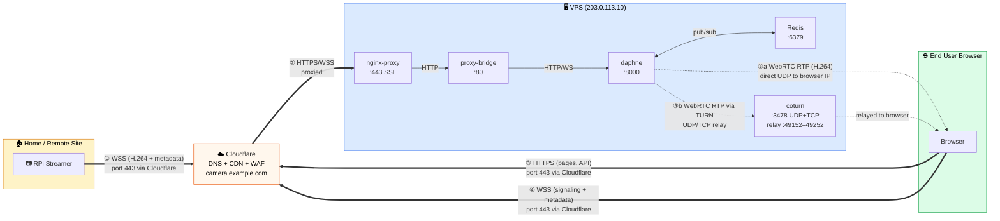

### Network Data Flow (Production)

How data flows through the network from each component to the end user:

| # | Path | Protocol | Ports | Goes through Cloudflare? |
|---|---|---|---|---|
| ① | RPi → VPS | **WSS** (WebSocket over TLS) | 443 | ✅ Yes |
| ② | Cloudflare → VPS | **HTTPS / WSS** | 443 → 80 → 8000 | — (CF to origin) |
| ③ | Browser → VPS | **HTTPS** (pages, login, recordings) | 443 | ✅ Yes |
| ④ | Browser → VPS | **WSS** (WebRTC signaling, live metadata) | 443 | ✅ Yes |
| ⑤a | VPS → Browser | **WebRTC RTP** (H.264 video, direct UDP) | random UDP | ❌ No — direct IP |
| ⑤b | VPS → Browser | **WebRTC RTP via TURN** (relay fallback) | 3478 + 49152–49252 UDP | ❌ No — direct IP |

> **Why TURN?** Carriers like Orange PL 5G use Symmetric NAT / CGNAT which blocks direct UDP (path ⑤a). TURN relay (path ⑤b) tunnels WebRTC through the coturn server so video still reaches the viewer.